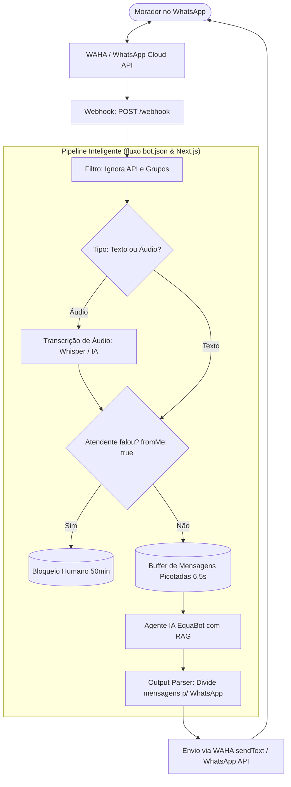

# ⚡ Guia Completo do Bot de WhatsApp: Vizinho de Alta Tensão
## Equatorial Energia Maranhão — São Luís e Região Metropolitana
**Desafio #486 · Hackathon Equatorial**
**Idealizador:** Jean Lucas Tourinho Fonseca
**Branch de Desenvolvimento:** `Marcos`

---

## 📌 1. Visão Geral e Contexto do Desafio

O programa **Vizinho de Alta Tensão** foi concebido no Desafio #486 para transformar a relação entre as comunidades vizinhas de ativos de energia elétrica (subestações e linhas de transmissão) e a Equatorial Maranhão.

### O Problema:
Moradores que vivem nas proximidades de linhas de transmissão e subestações em São Luís (em bairros como Tirirical, Cohatrac, Maracanã, Coroadinho, Cidade Operária, Vinhais, São Cristóvão, etc.) convivem diariamente com riscos que muitas vezes não conseguem enxergar:
- Cabos caídos no solo por tempestades ou acidentes;
- Arcos elétricos e centelhamento que saltam pelo ar;
- Pipas com cerol ou linha chilena enroscadas na rede;
- Queima recorrente de eletrodomésticos devido a descargas atmosféricas (raios) e oscilações bruscas;
- Invasões de áreas cercadas de subestações e tentativas fatais de furto de cabos.

### A Solução:
O **EquaBot — Vizinho de Alta Tensão**, um bot inteligente acessível diretamente pelo **WhatsApp** (onde a comunidade já está presente), que:
1. **Acolhe e Educa:** Explica de forma humanizada, simples e empática o que fazer e o que NUNCA fazer em cada situação de risco.
2. **Orienta sobre Eletrodomésticos e Ressarcimento:** Ensina medidas preventivas (DPS, filtros de linha, desligar da tomada em tempestades) e detalha o passo a passo completo de como solicitar o **Ressarcimento de Danos Elétricos na Equatorial Maranhão** (prazo de até 90 dias, não consertar antes da perícia, ter a Conta Contrato em mãos, acionar a Clara no WhatsApp `(98) 2055-7000` ou `116`).
3. **Identifica a Região:** Reconhece bairros de São Luís e mapeia o nível de atenção da vizinhança.
4. **Quiz e Selo Oficial:** Aplica um quiz interativo de 3 perguntas no próprio WhatsApp e emite o link do **Selo Digital Vizinho de Alta Tensão** assinado criptograficamente para compartilhamento no Status!

---

## 🏗️ 2. Arquitetura da Solução

O projeto implementa duas formas completas e interoperáveis de executar o bot:



### Componentes Principais:
1. **Filtro Anti-Loop e Grupos:** Ignora mensagens automáticas da própria API e foca exclusivamente em conversas privadas (1 a 1).
2. **Captação e Transcrição de Áudio:** Processa notas de voz do morador, transcrevendo o áudio para texto antes de enviar para o agente.
3. **Bloqueio para Atendimento Humano (Anti-Colisão):** Quando um atendente humano da Equatorial responde na conversa (`fromMe: true`), o bot é imediatamente pausado por **50 minutos** (TTL 3000s), evitando qualquer conflito entre a IA e o atendente.
4. **Buffer de Mensagens Picotadas (Debounce de 6.5s):** Quando o usuário envia várias mensagens curtas seguidas ("Oi", "tudo bem?", "caiu um fio aqui"), o buffer as agrupa em uma única mensagem coesa.
5. **Agente IA com RAG:** Munido com o conhecimento de segurança elétrica da Equatorial Maranhão, normas da ANEEL e dados georreferenciados de São Luís.
6. **Output Parser Humanizado:** Divide respostas longas em até 4 mensagens curtas, limpas e formatadas para leitura natural no celular.

---

## 🚀 3. Como Rodar com o n8n (`fluxo bot.json`)

O arquivo [`fluxo bot.json`](./fluxo%20bot.json) na raiz do projeto está 100% atualizado e configurado com todo o prompt do EquaBot, parâmetros de memória e nós de conexão.

### Passo 1: Subir o WAHA (WhatsApp HTTP API)
Você pode rodar o WAHA via Docker em segundos:
```bash
docker run -it -d --name waha -p 3000:3000 -v waha_data:/app/.sessions devlikeapro/waha
```

### Passo 2: Escanear o QR Code
1. Acesse o painel do WAHA: `http://localhost:3000/dashboard`
2. Crie uma nova sessão (ex: `default`) e escaneie o QR Code com o WhatsApp do número oficial ou de testes da Equatorial.

### Passo 3: Importar o Fluxo no n8n
1. No seu n8n, clique em **Workflows** > **Import from File**.
2. Selecione o arquivo [`fluxo bot.json`](./fluxo%20bot.json).
3. Configure as credenciais no n8n:
   - **OpenAI:** Chave de API para o modelo `gpt-4.1-mini` ou `gpt-4o-mini` e Whisper.
   - **WAHA API:** URL base `http://localhost:3000` (ou IP da sua VM).
   - **Redis:** Instância Redis para o buffer e chave de bloqueio humano.
   - **Postgres:** Banco de dados PostgreSQL para histórico de memória de conversas.
4. No nó **Webhook**, copie a URL de teste ou produção (ex: `http://seu-n8n:5678/webhook`) e configure-a no WAHA como Webhook URL da sessão.
5. Ative o Workflow!

---

## ⚡ 4. Como Rodar Diretamente pelo Next.js (Sem Dependências Externas)

O repositório já inclui o motor em TypeScript embutido em [`src/lib/bot/`](./src/lib/bot), pronto para rodar sem necessidade de subir n8n ou Redis:

### Endpoints Disponíveis:

| Rota | Método | Descrição |
| --- | --- | --- |
| `/api/whatsapp/webhook` | `GET` | Verificação de token da Meta Cloud API (`hub.verify_token`). |
| `/api/whatsapp/webhook` | `POST` | Webhook universal: recebe tanto payloads do **WAHA** (do `fluxo bot.json`) quanto da **Meta WhatsApp Cloud API**. |
| `/api/whatsapp/bot` | `POST` | Endpoint REST direto para testar conversas com o bot via JSON. |

### Exemplo de Chamada no Webhook WAHA (`POST /api/whatsapp/webhook`):
```bash
curl -X POST http://localhost:3000/api/whatsapp/webhook \
  -H "Content-Type: application/json" \
  -d '{
    "event": "message",
    "session": "default",
    "payload": {
      "id": "msg-001",
      "from": "5598988880000@c.us",
      "source": "web",
      "body": "minha TV queimou com a chuva forte, como peço ressarcimento à Equatorial?",
      "fromMe": false,
      "_data": { "Info": { "Type": "text", "IsGroup": false, "PushName": "Maria" } }
    }
  }'
```

### Exemplo de Teste Direto via REST (`POST /api/whatsapp/bot`):
```bash
curl -X POST http://localhost:3000/api/whatsapp/bot \
  -H "Content-Type: application/json" \
  -d '{
    "mensagem": "tem um cabo caído soltando faíscas aqui no Cohatrac",
    "telefone": "5598999991111",
    "nome": "Marcos"
  }'
```

---

## 📱 5. O que Testar no Bot (Cenários de Demonstração)

1. **Boas-vindas e Acolhimento:**
   - Digite: *"Oi, bom dia!"*
   - O bot se apresenta como EquaBot da Equatorial Maranhão em São Luís e apresenta o menu de temas.
2. **Cabo Caído no Chão:**
   - Digite: *"tem um cabo de energia caído no chão na minha rua"*
   - O bot orienta: manter 10 a 15 metros, tensão de passo, nunca tocar nem usar madeira, ligar 116 e 193.
3. **Eletrodomésticos Queimados & Ressarcimento:**
   - Digite: *"minha geladeira queimou com um raio durante a chuva, como peço ressarcimento?"*
   - O bot orienta: prazo de 90 dias (ANEEL), NÃO consertar nem jogar fora antes da vistoria, ter Conta Contrato, canais Clara (98 2055-7000) e 116.
4. **Pipas na Rede Elétrica:**
   - Digite: *"uma pipa enroscou no fio do poste, posso tirar?"*
   - O bot orienta: perigo fatal, cerol/linha chilena, deixar a pipa lá e nunca usar varas nem subir em postes.
5. **Reconhecimento de Bairro em São Luís:**
   - Digite: *"moro no Cohatrac"* ou *"moro no Tirirical"*
   - O bot reconhece o bairro, informa o nível de risco de acordo com os ativos locais e recomenda cuidados específicos.
6. **Quiz do Vizinho Consciente:**
   - Digite: *"quero fazer o quiz"*
   - O bot conduz as 3 perguntas educativas e, ao acertar as 3, emite o link com o **Selo Digital Oficial** para o Status!

---

## 🛡️ 6. Conformidade com LGPD
- Nenhuma coordenada GPS exata é armazenada ou exposta.
- O bot utiliza apenas o primeiro nome e o bairro informado pelo usuário.
- O id do selo é assinado por HMAC-SHA256 (`BADGE_SECRET`), tornando-o inviolável e impossível de ser forjado.
